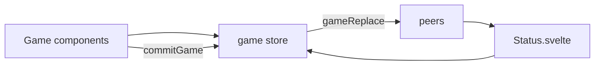

# AGENTS.md — Zendo client

Peer-to-peer [Zendo](https://www.looneylabs.com/content/zendo) web client: Svelte **5**, Vite **6**, TypeScript, [PeerJS](https://peerjs.com/). Game state is one `ZendoGameState` object in the `game` store ([`src/stores/writeGame.ts`](src/stores/writeGame.ts)). Schemas: [`src/schemas/game.json`](src/schemas/game.json), [`src/schemas/messages.json`](src/schemas/messages.json) — run `npm run schemas` after JSON edits.

## Flow



- **Connections / messages:** [`src/lib/Status.svelte`](src/lib/Status.svelte) — PeerJS, `display`, `peers`, `gameReplace`, `vote`, `chat` (toast), `notifyAbandon` (toast).
- **Play UI:** [`src/lib/Game.svelte`](src/lib/Game.svelte), [`src/lib/Game/`](src/lib/Game/).
- **Sync:** [`src/lib/gameSync.ts`](src/lib/gameSync.ts) — `commitGame(mutate, description?)` (shallow-clone root, broadcast unless `mutate` returns `false`), `broadcastGame`, `sendGameReplace`, `flushPeerSendBuffers` (abandon).
- **Roster:** [`src/lib/roster.ts`](src/lib/roster.ts) — `removeStudentFromGame`, `shouldSyncRosterOnPeerDisconnect` (master, or any peer if master offline). Disconnect removal is broadcast via `commitGame`.
- Inbound `gameReplace` is accepted from any peer (trusted mesh); bad JSON → toast, no crash.

## Game state (summary)

| Field | Role |
|--------|------|
| `master`, `students`, `currplayer` | Roles and turn |
| `koanType`, `koans`, `colours` | Play field |
| `koanPending`, `guessPending`, `guesses` | Review / history |
| `winner` | End of game |

## ViewKoan

[`ViewKoan.svelte`](src/lib/Game/ViewKoan.svelte) + [`viewKoanRender.ts`](src/lib/viewKoanRender.ts) + [`ViewKoanSupport/`](src/lib/ViewKoanSupport/). Reactive math (KaTeX), pyramids/dot matrix/cards; lazy `Cards.ts` and diagram modules. Per-instance `koanSvgScope` for SVG fragment ids. Graphviz: vendored `@viz-js/viz` (`npm run copy-graphviz` → `vendor/graphviz/viz.js`, [`Graphviz.ts`](src/lib/ViewKoanSupport/Graphviz.ts)). PlantUML: [`Plantuml.ts`](src/lib/ViewKoanSupport/Plantuml.ts) (`@plantuml/core`, sets `PLANTUML_VIZ`). SVG download via Blob.

## Guessing stones

[`guessingStones.ts`](src/lib/guessingStones.ts): spend on submit ([`MakeGuess.svelte`](src/lib/Game/ActionBar/MakeGuess.svelte)), refund on reject/withdraw; accept does not spend again.

## Where to edit

| Concern | Location |
|---------|-----------|
| Turn / actions | [`src/lib/Game/ActionBar/`](src/lib/Game/ActionBar/) |
| Field layout | [`fieldSegments.ts`](src/lib/fieldSegments.ts), [`Field.svelte`](src/lib/Game/Field.svelte) |
| Roster UI | [`Students.svelte`](src/lib/Game/Students.svelte) |
| Export | [`exportGame.ts`](src/lib/exportGame.ts) — deep-copy guesses; display names only on export copy |

## Commands

```bash
npm install          # postinstall runs copy-graphviz
npm run dev          # schemas + vite
npm run check        # svelte-check (a11y warnings OK)
npm run test         # Vitest, fixtures under test/ only
npm run build        # base /zendo
npm run schemas
```

CI: [`.github/workflows/ci.yml`](.github/workflows/ci.yml) — `npm ci`, schemas, check, test, build.

## Conventions

- Prefer `commitGame` over ad-hoc broadcast. Pure logic in `src/lib/*.ts` when testable.
- New components: Svelte 5 runes where helpful; existing code may stay on `$:` / `export let`.
- Do not commit unless asked. English UI copy only.
- `package.json` overrides: `svelte-markdown` → `"svelte": "$svelte"`.
